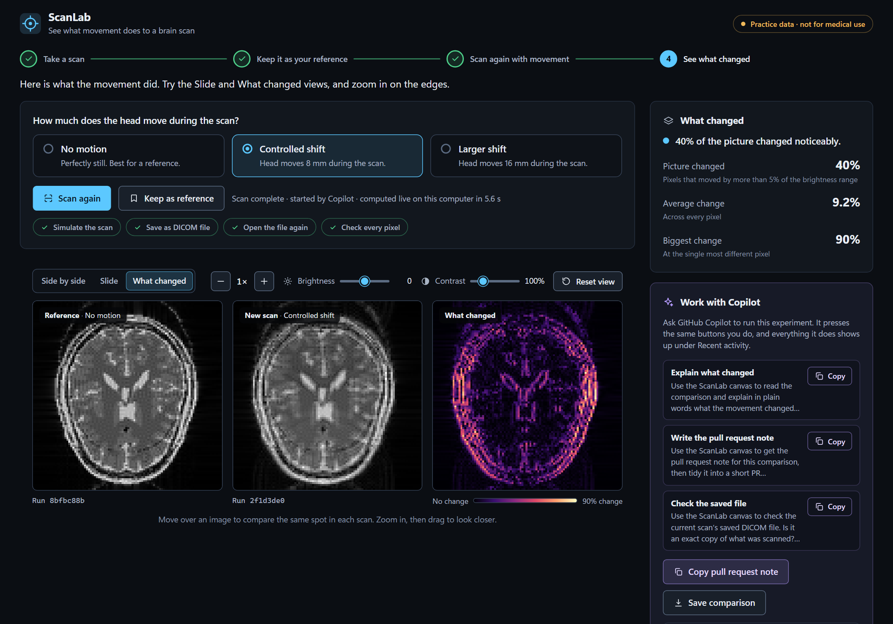
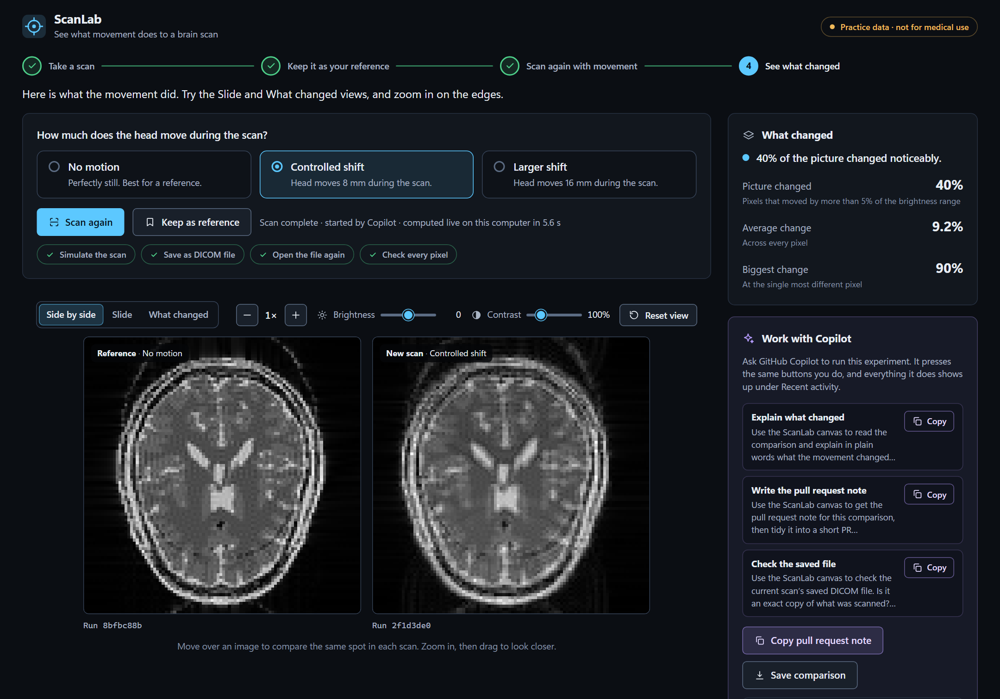
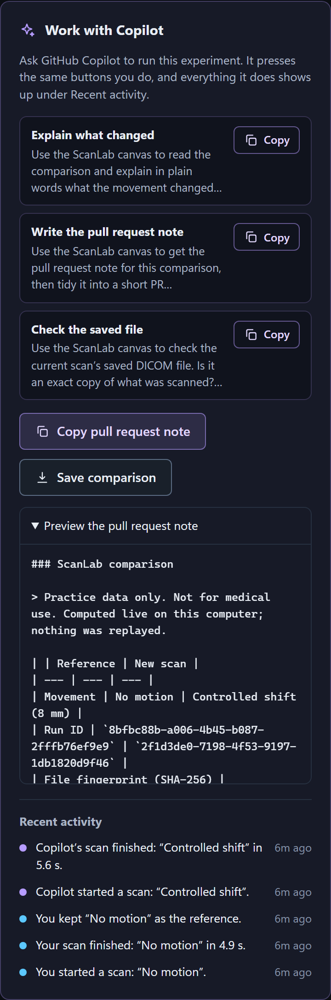
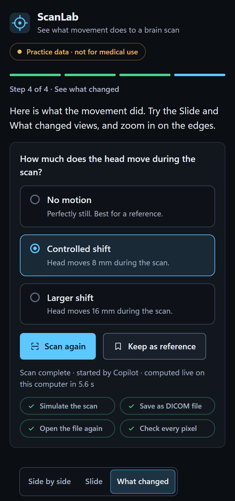
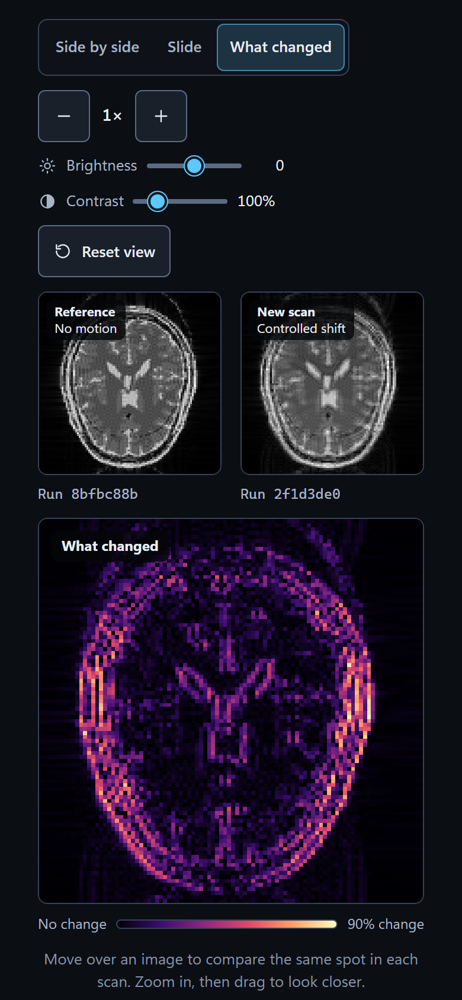

# ScanLab

**See what movement does to a brain scan, on practice data, with GitHub Copilot
working next to you.**

ScanLab is a small live imaging workbench. You take a scan, keep it as your
reference, scan again with the head moved, and see exactly what changed. It runs
on your own computer, as a web page and as a canvas inside the GitHub Copilot
app. Copilot can run the experiment for you and write up the evidence.

> **Practice data only.** ScanLab simulates a published digital brain phantom.
> There are no patient images. It is a learning demo, not a medical device, and
> it makes no clinical claims.



## Four steps

1. **Take a scan.** Choose how far the head moves (**No motion**, **Controlled
   shift** or **Larger shift**) and press **Take scan**. A real MRI simulation
   runs on your CPU.
2. **Keep it as your reference.** The scan is saved as a DICOM file, opened again
   and checked pixel by pixel. The picture you see is the one read back from the
   file. Keep it as the reference.
3. **Scan again with movement.** Pick a different movement and scan again. Your
   reference stays exactly as it was.
4. **See what changed.** Compare the two side by side, with a slider, or as a map
   of what moved.

Every scan is computed live. Nothing is pre-recorded or replayed.

## What it looks like



*Side by side, with linked zoom, brightness and contrast.*



*The Work with Copilot panel: prompts to copy, a pull request note built from the
real run, and a plain-words activity list that names who did what.*

| On a phone: set up the scan | On a phone: see what changed |
|---|---|
|  |  |

These are real browser captures of the running app, using practice data. The
"Copilot" entries in the activity list were sent through the same canvas actions
the Copilot app calls. They are not from a live Copilot app session.

## Quick start

You need **Julia 1.10.12**, **Node 22.20 or newer** and Git. The commands are
written for PowerShell on Windows. If Julia is not on your PATH, set `JULIA_EXE`
to its executable first.

```powershell
npm ci
npx playwright install chromium
npm run scanlab:setup
npm run scanlab:check
npm run scanlab
```

`scanlab:setup` installs the pinned Julia packages. `scanlab:check` is optional
and runs every ScanLab test, which takes several minutes. `scanlab` starts the
app. Wait for `ScanLab ready: <url>` and open that address.

The first start takes about three minutes while Julia compiles and rehearses a
scan on a throwaway session. After that, a scan takes about five seconds. The
address carries a private token for this computer, so do not share it.

## Use it with GitHub Copilot

1. In the GitHub Copilot app, add this folder and start a new session with
   **Workspace → Current checkout**.
2. Ask: `Open the existing scanlab canvas. Do not scaffold or edit anything.`
3. Ask Copilot to run it:

```text
Use the ScanLab canvas to run No motion, keep it as the reference, run Controlled shift, then explain in plain words what changed. Quote the real run IDs and numbers.
```

The page moves on its own, and each step appears under **Recent activity** as
Copilot's. Copilot can also draft the pull request note with the real run IDs and
fingerprints. The [Copilot guide](docs/copilot.md) covers the canvas actions, the
command-line bridge, the repository instructions, the skill and the readiness
task.

## Read more

| Read | For |
|---|---|
| [How ScanLab works](docs/how-it-works.md) | The science, the DICOM file, the service and its API, in plain words |
| [Presenting](docs/presenting.md) | A step-by-step demo script, and how to rehearse it |
| [ScanLab and GitHub Copilot](docs/copilot.md) | Canvas actions, the command-line bridge, templates and the readiness task |
| [Testing](docs/testing.md) | Every command, what each test suite covers, and what is not verified |
| [Request desk](docs/request-desk.md) | A second, smaller exercise with a different dataset |
| [Credits](docs/credits.md) | Libraries, data, research and citations |

## Built on

ScanLab reuses existing open-source projects instead of rebuilding them:
[KomaMRI](https://github.com/JuliaHealth/KomaMRI.jl) for the phantom and the scan
simulation, [MRIReco](https://github.com/MagneticResonanceImaging/MRIReco.jl) for
the image reconstruction and [DICOM.jl](https://github.com/JuliaHealth/DICOM.jl)
for the saved file. The backend is Julia. Node runs only the browser tests and the
helper scripts. See [Credits](docs/credits.md) for versions, licenses and
citations.

## Honest limits

- The saved file is a derived Secondary Capture DICOM, not a clinical MR image.
  No conformance certification is claimed.
- The tests cover the science, the saved file, the service, the canvas adapter and
  the web page. They do not drive the GitHub Copilot app itself, because the host
  blocks desktop automation of that app. See
  [Testing](docs/testing.md#what-has-not-been-verified).
- The activity names ("You", "Copilot", "A script") are labels the caller reports
  about itself. They are not security.

## Also in this repository

The [request desk](docs/request-desk.md) is a separate, smaller exercise: a
synthetic research review form and one coding task for Copilot. Run it with
`npm run setup` and `npm start`.

## License

[MIT](LICENSE). Third-party libraries keep their own licenses. See
[Credits](docs/credits.md).
